### Hello! My name is Carla 👋

I'm **Carla**, a Software Engineering student currently pursuing a double degree in Physical Engineering and Embedded Systems.

##

##

 
  
 

##

<picture data-importer="pacman">
  <source media="(prefers-color-scheme: dark)" srcset="https://raw.githubusercontent.com/ccarlaa/ccarlaa/pacman-output/pacman-contribution-graph-dark.svg?game=pacman">
  <source media="(prefers-color-scheme: light)" srcset="https://raw.githubusercontent.com/ccarlaa/ccarlaa/pacman-output/pacman-contribution-graph.svg?game=pacman">
  
</picture>

###

